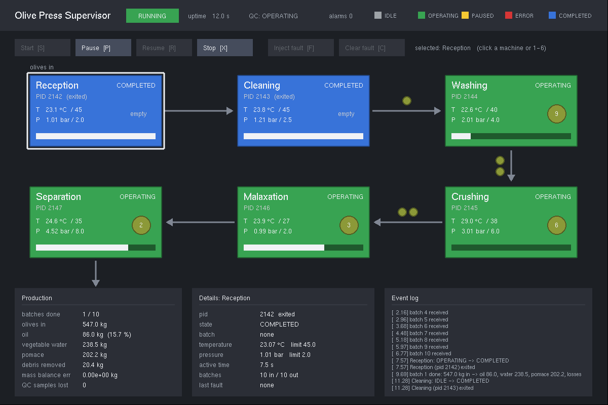

# Olive Press Simulation

ENCS4330 Real-Time Applications & Embedded Systems, Project 1 (Signals, Pipes & FIFOs).

One executable forks seven children (Reception, Cleaning, Washing, Crushing,
Malaxation, Separation, Quality Control). The parent is the **Supervisor**: it
owns the OpenGL window, collects telemetry and alarms without blocking, sends
control signals and keeps production totals.



## Build

Ubuntu / Debian packages:

```sh
sudo apt install build-essential freeglut3-dev
```

```sh
make            # olive_press + omp_bench
make debug      # -O0 -g build for gdb
make clean
```

## Run

```sh
./olive_press config/default.cfg              # GUI, press S (or click Start)
./olive_press config/default.cfg --autostart  # GUI, starts right away
./olive_press config/hot_day.cfg              # malaxer overheats, QC alarms, auto recovery
./olive_press config/default.cfg --headless   # no window, progress on stdout
```

The config file is plain `key = value`. Any key left out keeps its default, and
unknown keys are rejected so a typo cannot slip through. See
`config/default.cfg` for every key.

### GUI controls

| key | button       | what happens                                              |
|-----|--------------|-----------------------------------------------------------|
| S   | Start        | create the pipes and fork the seven children              |
| P   | Pause        | `SIGUSR1` to the six machines                             |
| R   | Resume       | `SIGUSR2` to the six machines                             |
| F   | Inject fault | `SIGRTMIN` to the selected machine, reception is held     |
| C   | Clear fault  | `SIGRTMIN+1` to the selected machine, reception released  |
| X   | Stop         | `SIGTERM` to every child, `SIGKILL` after 2 s if needed   |
| 1-6 | click a box  | select the machine shown in the details panel             |
| Q / Esc | -        | stop the line and close the window                        |

Colours: gray IDLE, green OPERATING, yellow PAUSED, red ERROR, blue COMPLETED.
Olive circles inside a machine are the batch it is working on; circles on an
arrow are batches written to that pipe and not yet read by the next stage.

### Headless commands

Without a window the supervisor reads simple commands from stdin, which is
also how the end to end tests drive it:

```
p        pause          r      resume
f N      fault machine N (1 = reception ... 6 = separation)
c N      clear fault on machine N
x        stop
```

## OpenMP benchmark

```sh
./omp_bench                    # all cores, 4000 samples x 4000 RK4 steps
./omp_bench --sweep            # 1, 2, 4 ... threads
./omp_bench -n 16 -s 20 -r 101 --sweep    # tiny job: overhead wins
```

Results and what they mean: [docs/benchmark.md](docs/benchmark.md).

## Debugging with gdb

`make debug` rebuilds with `-O0 -g`. By default gdb stays in the parent
after `fork()`. To step into a child:

```
gdb --args ./olive_press tests/fast.cfg --headless
(gdb) set follow-fork-mode child      # follow the next fork into the child
(gdb) set detach-on-fork off          # keep the other processes under gdb too
(gdb) break crushing_run
(gdb) run
(gdb) info inferiors                  # list parent and children
```

An already running child can also be attached by its PID from the GUI:
`gdb -p <pid>`.

## Tests

```sh
make test
```

Runs the IPC and config unit tests, then `tests/run_headless.sh`, which drives
the real binary through a normal run, a repeatability check, an over
temperature alarm, every operator control, a stop, and a child killed with
`SIGKILL`. It also checks that no process is left behind afterwards.

## Layout

```
include/       shared contract: common.h, ipc.h, config.h
common/        read_full/write_full, config loader, name tables
processes/     supervisor.c, mock_stages.c, (real stages go here)
graphics/      graphics.c - GLUT window
benchmark/     openmp_benchmark.c
src/main.c     argument parsing, headless loop
config/        default.cfg, hot_day.cfg
tests/         unit tests, end to end script and short configs
docs/          protocol notes, benchmark results, demo script
```

`processes/mock_stages.c` holds stand-in versions of all seven children. They
are declared weak, so dropping a real `processes/crushing.c` with
`crushing_run()` into the tree replaces that one mock on the next `make` with
no other change.
